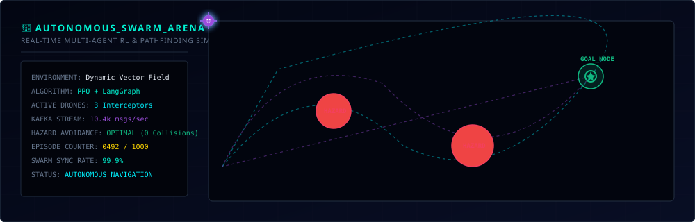
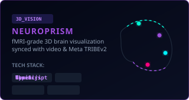
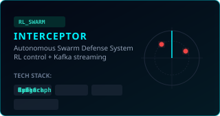
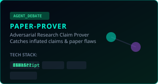
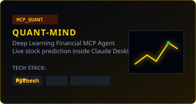
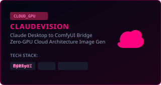
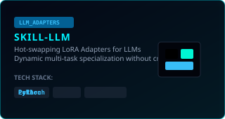
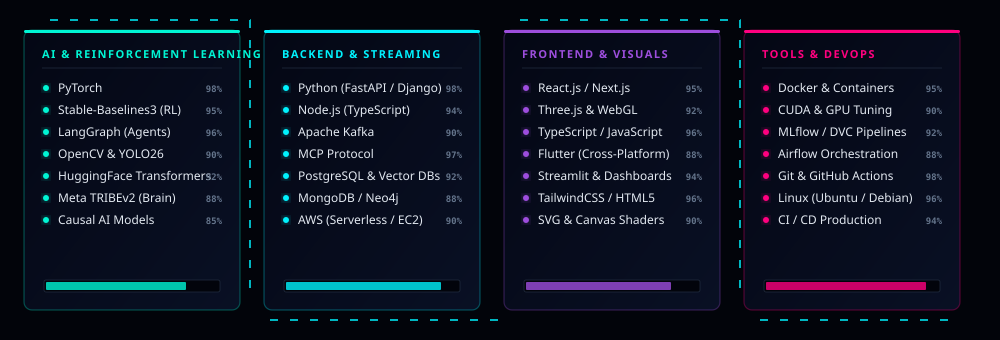

<p align="center">
  
</p>

<p align="center">
  <em>AI/ML Engineer building autonomous agentic systems, reinforcement learning agents, and bio-digital neural visualizers.</em><br>
  <strong>Agentic AI • Reinforcement Learning • MCP Protocol • Computational Neuroscience • Computer Vision</strong>
</p>

<p align="center">
  <a href="https://linkedin.com/in/NikhilChapkanade"></a>
  <a href="https://instagram.com/i_am_nikkhil"></a>
  <a href="mailto:nikhilchapkanade@gmail.com"></a>
  <a href="https://leetcode.com/u/nikhilchapkanade/"></a>
</p>

---

### 🧠 About Me &amp; System Architecture

```python
class Nikhil:
    location     = "Pune, India 📍"
    role         = "AI / ML Engineer"
    
    core_stack   = ["Agentic AI", "Reinforcement Learning", "MCP Protocol",
                    "Computer Vision", "Computational Neuroscience"]
    devops       = ["AWS (EC2 • S3 • Lambda)", "Docker", "MLOps", "CI/CD"]
    building     = "Autonomous systems that learn, reason, and act self-sufficiently"
    exploring    = "LangGraph • Stable-Baselines3 • Causal AI • Kafka • Three.js"
    
    latest_ship  = "🧠 NeuroPrism — fMRI-grade 3D brain visualization with Meta TRIBEv2"
    
    next_goals   = ["☁️ AWS Certified Solutions Architect",
                    "🔄 Production MLOps Pipelines (MLflow + DVC + Airflow)",
                    "🤖 Scalable Multi-Agent Autonomous Swarms"]
    
    def __repr__(self):
        return "shipping code that thinks, sees, and acts for itself 🚀"
```

<details>
  <summary><strong>🔍 CLICK TO EXPAND SYSTEM DIAGNOSTICS &amp; RESEARCH ARCHITECTURE</strong></summary>
  <br/>
  <table>
    <tr>
      <th>Domain</th>
      <th>Architectural Focus</th>
      <th>Key Libraries &amp; Tools</th>
    </tr>
    <tr>
      <td>🤖 <strong>Agentic AI &amp; MCP</strong></td>
      <td>Multi-agent delegation, model context protocol tools, tool-augmented LLM reasoning</td>
      <td><code>LangGraph</code> <code>MCP Protocol</code> <code>Llama 3.2</code> <code>OpenRouter</code></td>
    </tr>
    <tr>
      <td>🎯 <strong>Reinforcement Learning</strong></td>
      <td>Model-free RL, PPO, Double DQN, autonomous swarm pathfinding &amp; defense</td>
      <td><code>Stable-Baselines3</code> <code>PyTorch</code> <code>Gymnasium</code> <code>Kafka</code></td>
    </tr>
    <tr>
      <td>🧠 <strong>Computational Neuroscience</strong></td>
      <td>fMRI-grade 3D cortical heatmaps, signal decoding, visual cortex sync</td>
      <td><code>Meta TRIBEv2</code> <code>Three.js</code> <code>WebGL</code> <code>Python</code></td>
    </tr>
    <tr>
      <td>👁️ <strong>Computer Vision &amp; 3D</strong></td>
      <td>Real-time tracking, vehicle counting, zero-GPU cloud image generation</td>
      <td><code>OpenCV</code> <code>YOLO26</code> <code>ComfyUI</code> <code>React.js</code></td>
    </tr>
  </table>
</details>

---

<h3 align="center">🎯 Autonomous Swarm &amp; Pathfinding Arena</h3>
<p align="center">
  
</p>

---

<h3 align="center">🚀 Featured Project Modules</h3>

<p align="center">
  <a href="https://github.com/Nikhilchapkanade/NeuroPrism">
    
  </a>
  <a href="https://github.com/Nikhilchapkanade/INTERCEPTOR">
    
  </a>
  <a href="https://github.com/Nikhilchapkanade/Paper-Prover">
    
  </a>
</p>

<p align="center">
  <a href="https://github.com/Nikhilchapkanade/quant-mind">
    
  </a>
  <a href="https://github.com/Nikhilchapkanade/ClaudeVision">
    
  </a>
  <a href="https://github.com/Nikhilchapkanade/Skill-LLM">
    
  </a>
</p>

<details>
  <summary><strong>📂 CLICK TO EXPAND COMPLETE REPOSITORY ARCHIVE</strong></summary>
  <br/>
  <table>
    <tr>
      <th>Project</th>
      <th>Description</th>
      <th>Stack</th>
    </tr>
    <tr>
      <td>📚 <strong><a href="https://github.com/Nikhilchapkanade/BigDoc-Server">BigDoc-Server</a></strong></td>
      <td>MCP server for recursive LLM reasoning — unlimited context via search &amp; thinking tools</td>
      <td><code>TypeScript</code> <code>MCP</code> <code>LLM</code></td>
    </tr>
    <tr>
      <td>🔌 <strong><a href="https://github.com/Nikhilchapkanade/Mcp-Core">Mcp-Core</a></strong></td>
      <td>RAG agent with MCP and Llama 3.2 — connects tools and knowledge bases</td>
      <td><code>Python</code> <code>MCP</code> <code>Llama</code></td>
    </tr>
    <tr>
      <td>🔗 <strong><a href="https://github.com/Nikhilchapkanade/MCP-CLI">MCP-CLI</a></strong></td>
      <td>MCP client using Python and OpenRouter for tool-augmented LLM interactions</td>
      <td><code>Python</code> <code>MCP</code> <code>OpenRouter</code></td>
    </tr>
    <tr>
      <td>👁️ <strong><a href="https://github.com/Nikhilchapkanade/YOLO26n">YOLO26n</a></strong></td>
      <td>Real-time vehicle detection, tracking &amp; counting using the YOLO26 model</td>
      <td><code>Python</code> <code>YOLO</code> <code>OpenCV</code></td>
    </tr>
  </table>
</details>

---

<h3 align="center">🛠️ Cybernetic Skill Matrix &amp; Arsenal</h3>

<p align="center">
  
</p>

---

<h3 align="center">📊 Quantum Telemetry &amp; Activity</h3>

<p align="center">
  
  
</p>

<p align="center">
  
</p>

<p align="center">
  
</p>

---

<p align="center">
  
</p>
